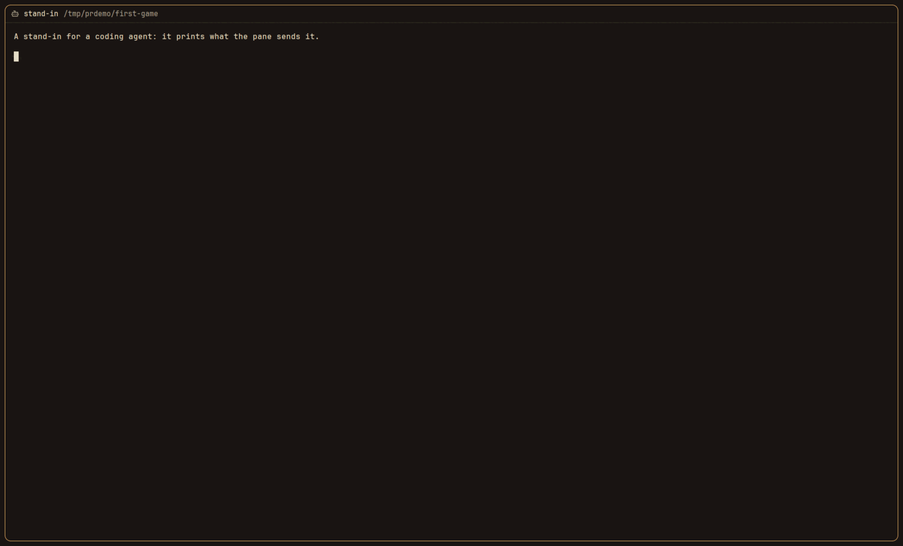

# herdr-stuff

Mods for the [Herdr app](https://herdr.dev), one folder each under `mods/`.

| Mod | What it does |
| --- | --- |
| [nexus](mods/nexus) | Nexus threads beside your terminals: what waits on you, live conversations, answering questions, reviews and landing, pipeline items, the cluster and usage |
| [cosy](mods/cosy) | A whole-window lofi café layout (`layouts/cosy.json`) cut from one painting: terminals as the window onto a snowy street, tabs as pendant lamps, spaces as a stack of books with the agents as cups under them, a menu card with keys as prices |
| [pr](mods/pr) | The pull request of the branch you are on, as a pane beside your terminals: its stage, what blocks merging, every check and the step a running job is on, its files and diffs, notes on them sent to the tab's agent or posted on GitHub as a review, GitHub's review threads among the lines, and Merge |
| [tuido](mods/tuido) | Your tuido todo lists in a floating window: complete, add, open in your editor, sort, archive and sync |

The [pr](mods/pr) mod, beside a terminal:



## Install

Clone the repo and link a mod into the app's mods:

```sh
git clone https://github.com/ramtinJ95/herdr-stuff.git
ln -s "$PWD/herdr-stuff/mods/<mod>" ~/.config/herdr-app/mods/<mod>
```

A mod's `keys.json` holds the keys it expects; merge its sections into `~/.config/herdr-app/keys.json`, keeping any key you already use. A `git pull` updates it. The app does not hot-reload a linked mod, so close and reopen it after a change.

## Develop

Check a mod with `herdr-app check mods/<mod>`, and run every mod's tests with `npm test`. To add a mod, create `mods/<mod>/` with its `mod.json` and `main.js`, and list it in the table above.
