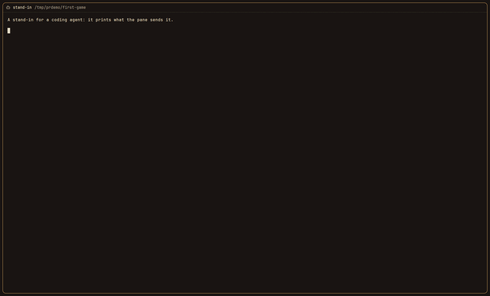
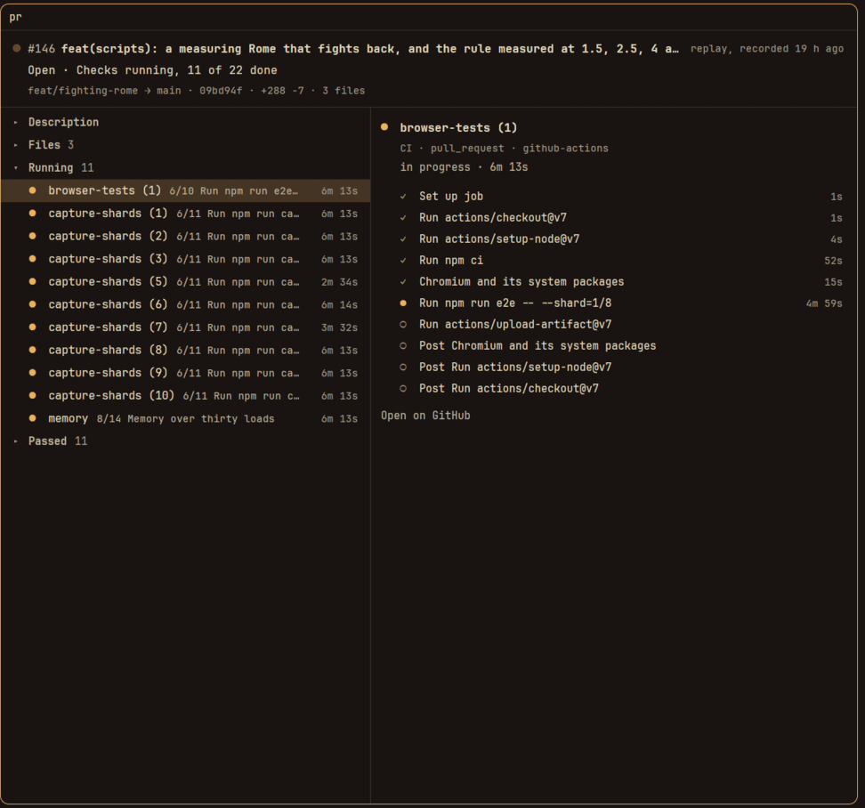
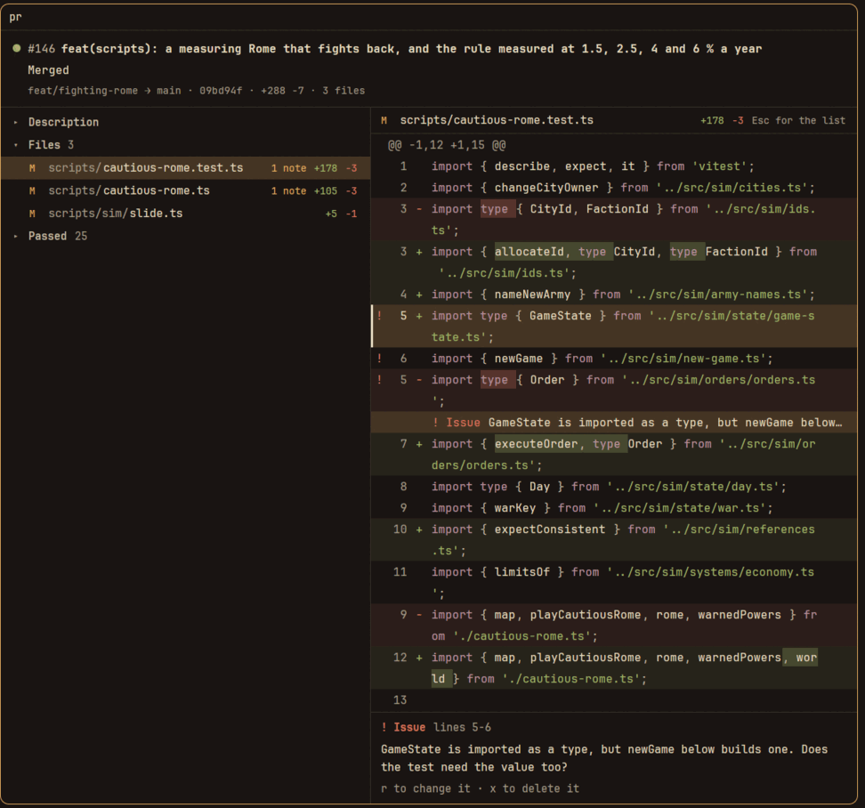
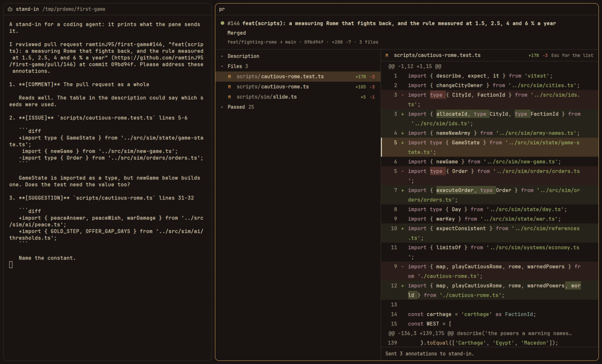
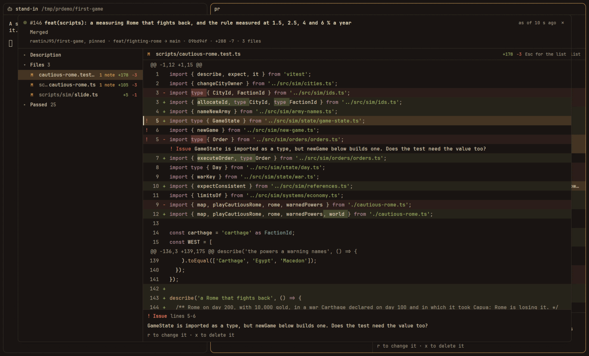

# PR pane

The pull request of the branch you are on, as a pane beside your terminals in the [Herdr app](https://herdr.dev): where it stands, what blocks merging, its checks as they run, its diffs, and a review you send to the agent in the tab or post on GitHub.



The first half of the clip replays a recorded run of checks; the second half is the pane on a real pull request, with a stand-in for the agent that prints what it is sent.

## What you get

- **Where it stands.** No pull request yet, draft, open, merged or closed. For an open one, whether it can merge and what blocks it: conflicts, behind the base branch, a review, required checks, a branch rule.
- **Checks as they run.** Failed, running, cancelled, passed and skipped, each running GitHub Actions job with the step it is on, and the steps of the check you select.
- **Description and conversation.** As Markdown, with who opened it, its reviewers and where each stands, its labels, and the comments and reviews under it.
- **Files and diffs.** GitHub's own patch for each file, in syntax colours.
- **Review.** Notes on lines and ranges, sent to the tab's agent as one review or posted on GitHub. GitHub's review threads stand among the lines, to reply to, resolve or hand to the agent.
- **Merge.** Offered only when GitHub reports the pull request clean, and it takes two presses.

## Install

You need the Herdr app and the [GitHub CLI](https://cli.github.com) (`gh`), logged in: `gh auth status` says whether you are.

1. Clone the repository and link the mod into the app:

   ```sh
   git clone https://github.com/ramtinJ95/herdr-stuff.git
   ln -s "$PWD/herdr-stuff/mods/pr" ~/.config/herdr-app/mods/pr
   ```

2. Add its two keys to the `global` section of `~/.config/herdr-app/keys.json`, keeping any key you already use:

   ```json
   "ctrl-f o": { "command": "pane.split", "args": { "direction": "right", "mod": "pr" } },
   "ctrl-f shift-o": "pr.close"
   ```

3. For syntax colours in the diffs, install the colour helper's one package. It needs `node`, and takes 49 MB in a folder git ignores. Without it the pane works the same and its diffs are plain.

   ```sh
   cd herdr-stuff/mods/pr/pierre && npm install
   ```

A `git pull` updates the mod. The app does not hot-reload a linked mod, so close the pane and open it again after one.

## Use it

**Open it.** In a terminal whose folder is on a branch with a pull request, press **Ctrl-f o** (or pick **Pull request** in the command palette). The pane opens to the right and has the keyboard. It follows its tab: focus another terminal, or change branch, and it shows that branch's pull request. **Ctrl-f Shift-o** closes it from any pane; `q` closes it from inside.

**Read the headline.** The first lines say where the pull request stands and the one thing that matters now: checks running and how many are done, a required check failing, waiting for review, conflicts, ready to merge.



**Watch the checks.** They are grouped as failed, running, cancelled, passed and skipped. A running job's row says which step it is on. Move with `j` and `k`; the selected check's steps show beside the list, or under its row in a narrow pane. `o` opens it on GitHub.

**Read the diff.** Open **Files** with Enter, select a file, and press `l` to put the keyboard in its diff.



**Review it.** In a diff, `c`, `s` and `i` note a comment, a suggestion or an issue on the line the cursor is on, or on a range started with `v`. `a` asks the agent a question about those lines, sent as soon as you press Enter. Then `y` and Enter send every note to the agent in the tab as one review, with the diff lines each is about; `Y` and Enter post them on GitHub instead.



**Merge.** When GitHub reports the pull request clean, a Merge button shows. `m` says what will happen, and a second `m` does it.

**Want more room?** `w` opens the same pull request in a window over the layout, on the file and line you were at.



## Keys

In the pane:

| Key | Does |
| --- | --- |
| j, k, arrows | Move the selection |
| Enter, Space | Open or close the description, the files or a group, show a check's steps, or go into a file's diff |
| l | Go into the selected file's diff |
| o | Open the selected check, the pull request, or from a file its files page, on GitHub |
| r | Refresh now |
| w | Open the pull request in a window over the layout |
| m | Merge: the first press says what will happen, the second does it. A held key does neither |
| Esc | Take back the first press of Merge; in a narrow pane, leave a diff or a check's steps for the list; in a window, close it |
| q | Close the pane, or the window |

In a diff:

| Key | Does |
| --- | --- |
| j, k, arrows | Move the cursor a line |
| d, u | Move it half a screen |
| g, b or G | First line, last line |
| v | Start a range at the cursor, or end it. Shift-click does the same from the cursor to the line clicked |
| c, s, i | Note a comment, a suggestion or an issue on the line or range |
| a | Ask a question about the line or range: it goes to the agent as soon as you press Enter |
| o | Note a comment on the pull request as a whole |
| h, l | The annotation or GitHub thread before or after, in whichever file it is |
| r, x | Change or delete the annotation the cursor is on. On a GitHub thread, `r` replies to it |
| z | Resolve the GitHub thread the cursor is on, or open a resolved one again |
| f, then Enter | Send the GitHub thread the cursor is on to the agent, with the lines it is on |
| n, p | The next or previous file |
| w | Open this diff in a window, at this line |
| y, then Enter | Send every comment, suggestion and issue to the agent as one review. They leave the pane once sent, and the questions already asked with them; a question whose asking failed stays |
| Y, then Enter | Post them on GitHub as one review, each a comment on its lines. They leave the pane once posted, as with `y` |
| A, then Enter | Approve the pull request on GitHub, with them if there are any |
| Esc | Give up the field, the range, then the diff, one at a time; in a window, once more closes it |

## Good to know

- **It writes to GitHub only when you say so.** A merge, a posted review, an approval and a reply each take Enter or a second press, in answer to a line that says what will happen. Resolving a thread (`z`) acts at once, and a second `z` takes it back. `herdr-app do` and key bindings cannot merge or approve.
- **A review goes to an agent, never a shell.** It is typed into the terminal of the agent in the tab. A tab with only a shell gets nothing, since a shell would run the words.
- **Your notes are kept** per pull request until they are sent or deleted, so closing the pane loses none.
- **It asks GitHub sparingly.** Every 10 seconds while checks run, every 60 seconds once they have settled, never for a merged or closed pull request, and not at all while its tab is not the one shown. A pane left visible on a running pull request uses about 650 of GitHub's 5,000 points an hour.
- **Any pull request, not only this branch's.** A pane can be pinned to one: `herdr-app do pane.split --direction right --mod pr --props '{"pr":"cli/cli#9000"}'`.
- **It shows no toasts** and opens nothing over the window unless you press `w`. Errors are a line in the pane.

## Not there yet

- A status dot on the tab for pull requests in tabs you are not looking at. The tab bars are other mods.
- Checks beyond the first 100 are counted, not listed.
- A space on another machine runs `gh` there. That path is written and has not been run.
- Only GitHub Actions jobs have steps. Another service's check shows its state, description and link.
- A running job's log. GitHub gives it only when the job ends.
- "Request changes" as a verdict, a new comment under the description, and editing or deleting what is on GitHub.
- Threads beyond the first 100, comments beyond a thread's first 30, and the conversation before its latest 30 comments and 30 reviews are counted, not shown.
- An annotation or a reply longer than one line, and the agent's answer to a question in the pane. An annotation's or a thread's row among the lines is cut at the pane's edge and does not fold; the bar under the diff has it whole.

## More

- [Reference](docs/reference.md): everything the pane does, in detail. Which pull request it shows, the description, files and diffs, reviewing, the window, Merge, when it asks GitHub, layouts.
- [Internals](docs/internals.md): how the mod is built and tested. Its modules, the state table the tests check, and recording and replaying real pull requests.
